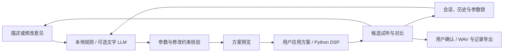

# 架构与接口

SoundSketch 是“自然语言驱动的可控噪声合成与听感表达 Agent”。当前实现围绕嗡鸣、尖啸、间歇敲击三个听感原型，通过参数规划、DSP 工具调用和用户反馈组织多轮表达。模型不训练、不微调，音频在本地生成。



## 模块边界

| 模块 | 职责 |
| --- | --- |
| [`parameters.py`](../soundsketch/parameters.py) | 不可变 `SoundParams`、数值范围、整数类型、频带与 Nyquist 约束、字段锁定 |
| [`planner.py`](../soundsketch/planner.py) | 本地描述映射、可选 LLM 规划、修改方向与保留项校验、澄清与降级 |
| [`adapters.py`](../soundsketch/adapters.py) | 文字 API、独立 Gemini 原录音理解、未启用的素材/音效生成扩展点 |
| [`proposals.py`](../soundsketch/proposals.py) | 有限容量的待应用方案、有效期、旧会话状态检查、一次性应用 |
| [`dsp.py`](../soundsketch/dsp.py) | 谐波音、带限噪声、调幅、衰减敲击及混合；PCM WAV 写出 |
| [`session.py`](../soundsketch/session.py) | 本地 JSON、候选、版本分支、用户选择与反馈、恢复、确认和导出 |
| [`analysis.py`](../soundsketch/analysis.py) | 原始 PCM WAV 的 Welch 频谱、RMS 包络与方法记录 |
| [`cases.py`](../soundsketch/cases.py) | 经验案例的数据约束；默认空库 |
| [`web.py`](../soundsketch/web.py) / [`static/`](../soundsketch/static/) | Flask 本机 API 与无构建依赖的网页 |

## 参数规划与执行

文字规划器仅返回 `kind`、`patch`、`clarification`。`patch` 是白名单字段到数值的映射；生成过程不执行 LLM 生成的 Python 代码。

初始方案从原型默认参数出发。修改方案继承当前选中候选，只应用明确改变的字段。数值必须通过本地验证；没有静默截断越界值，也没有自动重置整个原型。文字中的“音量不变”形成本轮保留约束，表单的参数锁用于后续版本。这些约束保证对应参数保持；用户是否感觉响度保持，需要另外通过试听判断。

“更低沉”“起伏慢一点”“敲击间隔更长”分别对应频率、调幅速率和脉冲间隔。矛盾、未映射的附加要求或当前原型中不生效的修改会要求澄清。初始候选沿一个可用特征提供通常三个对照；边界情况下至少两个有效不同候选，否则要求调整。后续修订生成一个新候选，并通过 A/B 控件与历史比较。

方案预览不生成 WAV、不写会话。应用时读取服务端保存的已校验方案，不再调用模型。待应用方案只存在当前进程内存中，30 分钟有效、最多 100 份；已消费或会话更新后的旧方案被拒绝。生成后的版本保存规划记录、实际参数、种子及模型调用元数据。

## 本机 HTTP 接口

所有 POST 请求要求 `X-SoundSketch: 1`；JSON 操作还需 `Content-Type: application/json`。本机 Host 和 Origin 检查限制跨站写入。上传录音使用 multipart 表单。

| 接口 | 用途 |
| --- | --- |
| `GET /api/status` | 本地运行和可选模型配置状态，不返回密钥 |
| `POST /api/plans` | 根据描述预览初始方案 |
| `POST /api/plans/<id>/apply` | 空 JSON 应用已保存方案 |
| `GET /api/sessions` | 列出本地会话 |
| `GET /api/sessions/<id>` | 打开会话及历史 |
| `POST /api/sessions/<id>/select` | 选择当前版本的候选 |
| `POST /api/sessions/<id>/preview` | 根据反馈或显式参数预览修改 |
| `POST /api/sessions/<id>/undo`、`restore` | 撤销至父版本或恢复指定版本 |
| `POST /api/sessions/<id>/reference` | 保存原始 PCM WAV 并本地分析 |
| `POST /api/sessions/<id>/understand` | 明确授权后发送所选原录音进行可选理解 |
| `POST /api/sessions/<id>/confirm` | 确认当前候选及听感描述 |
| `GET /api/sessions/<id>/export` | 下载已确认结果的 ZIP |

旧的一步式 `POST /api/sessions`（创建）和 `POST /api/sessions/<id>/revise`（修改）保留兼容性。接口错误不会返回原始供应商异常或密钥。

初始方案请求示例：

```json
{
  "description": "持续低沉的嗡鸣，缓慢起伏",
  "kind": "hum",
  "scene": "",
  "timing": "",
  "use_model": false
}
```

修改预览请求示例：

```json
{
  "feedback": "起伏慢一点，音量不变",
  "locked_fields": ["frequency_hz"],
  "use_model": false
}
```

预览响应包括 `id`、`task`、`params`、`patch`、`changes`、`mode`、`notice`、`clarification`、锁与保留项；需要澄清时 `id` 为 `null`。应用响应包括 `session`、`clarification` 和 `status`。完整请求约束与行为可参阅 [`test_plan_preview.py`](../tests/test_plan_preview.py)。

## 声音与复现

默认生成 24 kHz、4 秒、单声道、16 位 PCM WAV。随机噪声由固定种子产生；数字增益默认 0.2，上限 0.5。分量有界化后进行混合，最终应用增益，不通过输出归一化抵消音量修改。输出检查非有限值和满幅样本，片段带淡入淡出。

`mix` 是 Python/参数接口中已有的混合原型，网页初始入口只开放三个目标原型。参数独立不保证心理声学感受独立；改变频率可能影响主观响度和音色。数字幅值与 dBFS 均不是现场声压级。

同参数、种子和运行环境可字节级复现；不承诺跨 NumPy/SciPy 版本或平台的浮点结果完全相同。导出包记录依赖版本与 WAV 哈希，支持：

```shell
python -m soundsketch.render parameters.json reproduced.wav
```

已有输出路径会被拒绝覆盖。

## 观测、表达和未来扩展

- **原始录音**是用户提供的观测，来源真实性未经独立验证；保存原字节，测量方法与参数随分析结果保存。
- **案例库**是有出处的经验先验，目前为空。合成演示必须标记为 `synthetic_demo`。
- **生成音频**是听感表达。用户选择候选表示其主观接近程度，不构成现场频率或真实声源的新证据。

原录音分析目前独立展示，没有自动拟合合成参数，也没有自动检索真实案例。原因假设、排查建议、物理声源建模和压缩机项目的业务集成属于后续扩展；当前版本不提供设备故障诊断。接入其他项目时可以复用参数对象、DSP 函数、原录音分析或 HTTP 接口，并继续保留各类数据的来源标签。

返回 [README](../README.md) · 查看 [配置与本地数据](configuration.md)
